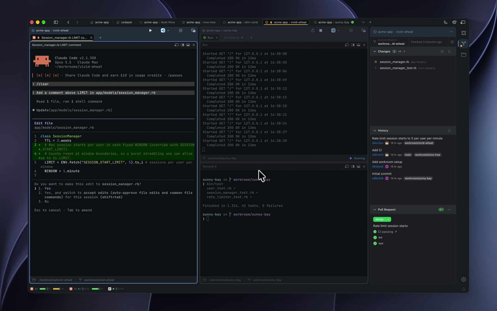

# Workroom

True parallel software development in a native MacOS development environment.

Workroom is a Mac app for working on many tasks at once. Each task gets its own workroom: a separate
copy of your project on its own branch, with its own terminals, history and diffs. Run a dev server in
one workroom, a coding agent in another and a test suite in a third, and none of them gets in the
others' way.

<p align="center">
  <a href="https://codaset.dev/workroom">
    
  </a>
</p>

<p align="center">
  <a href="https://codaset.dev/workroom/download"><strong>⬇&nbsp;&nbsp;Download for macOS</strong></a>
  &nbsp;·&nbsp;
  <a href="https://codaset.dev/workroom/docs"><strong>Documentation</strong></a>
  &nbsp;·&nbsp;
  <a href="CONTRIBUTING.md">Contributing</a>
</p>

## Install

Download the app, open the `.dmg` and drag **Workroom** into Applications. It needs a Mac with Apple silicon
and macOS 15 Sequoia or later, and it updates itself.

The `workroom` command-line tool is bundled inside the app. To use it on its own, on macOS or Linux:

```bash
curl -fsSL https://raw.githubusercontent.com/joelmoss/workroom/master/install.sh | sh
```

## Documentation

Everything else, from your first workroom to the CLI reference, is at
**[codaset.dev/workroom/docs](https://codaset.dev/workroom/docs)**. The pages are written in
[`docs-site/`](docs-site/), so a fix to the docs is a pull request to this repo.

## Contributing

Issues and PRs are welcome. See [CONTRIBUTING.md](CONTRIBUTING.md) for the local dev setup and the
test and lint gates, and for links to the architecture and the release process.

## License

[MIT](MIT-LICENSE)
